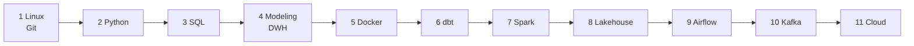

# 🛠️ Data Engineering Roadmap

**A simple, step-by-step list of resources to become a Data Engineer.**
11 small levels. Start at Level 1 and move down.

---

## 🗺️ The path

## 📑 Levels

| # | Level |
|---|---|
| 1 | [Linux and Version Control](#level-1-linux-and-version-control) |
| 2 | [Python](#level-2-python) |
| 3 | [Databases and SQL](#level-3-databases-and-sql) |
| 4 | [Data Modeling and Warehousing](#level-4-data-modeling-and-warehousing) |
| 5 | [Docker](#level-5-docker) |
| 6 | [dbt](#level-6-dbt) |
| 7 | [Spark](#level-7-spark) |
| 8 | [Lakehouse and File Formats](#level-8-lakehouse-and-file-formats) |
| 9 | [Airflow](#level-9-airflow) |
| 10 | [Kafka and Streaming](#level-10-kafka-and-streaming) |
| 11 | [Cloud](#level-11-cloud) |

Then: [Projects](#-projects) · [Interview prep](#-interview-prep) · [Books](#-books) · [Channels](#-channels-and-newsletters) · [DP-700 Certification](#-dp-700-certification) · [Contribute](#-contribute)

## How to use

1. Take it one level at a time, and give Levels 1 to 3 your full attention. They are the foundation, and everything after them gets much easier once they feel solid. You've got this!
2. Start with the ⭐ resources. They come first in every level. The rest are extras.
3. Build something small after each level and push it to GitHub.

**Legend:** ⭐ Start here · 🎥 Video · 📖 Book · 🧪 Practice

---

## Level 1: Linux and Version Control

**Start here**
- ⭐ [Linux course](https://youtu.be/gojeTqXdBH0) 🎥
- ⭐ [Version Control (Git and GitHub)](https://youtu.be/Q6G-J54vgKc) 🎥

**More**
- [Bash Scripting Tutorial (freeCodeCamp)](https://www.freecodecamp.org/news/bash-scripting-tutorial-linux-shell-script-and-command-line-for-beginners/)
---

## Level 2: Python

**Start here**
- [Elzero Web School](https://www.youtube.com/@ElzeroWebSchool) 🎥 Python from scratch
- [Python Basics, Part 2](https://www.youtube.com/watch?v=mlbe7Vxr7yA) 🎥
- ⭐ [Exploratory Data Analysis using Python](https://youtu.be/KeVlGtU8Zjs) 🎥
---

## Level 3: Databases and SQL

**Start here**
- ⭐ [Databases and SQL playlist](https://www.youtube.com/playlist?list=PLoRh0POuk1Rw-BZU-DPI6cA_c5W9_2uF_) 🎥
- ⭐ [MySQL course](https://youtu.be/kb-_GbpH3sQ) 🎥

**Practice (do these alongside the playlist)**
- [SQLBolt](https://sqlbolt.com/) interactive lessons 🧪
- [SQLZoo](https://sqlzoo.net/wiki/SQL_Tutorial) 🧪
- [PostgreSQL Exercises](https://pgexercises.com/) 🧪
- [LeetCode Database](https://leetcode.com/problemset/database/) 🧪
- [HackerRank SQL](https://www.hackerrank.com/domains/sql) 🧪
---

## Level 4: Data Modeling and Warehousing

**Start here**
1. ⭐ [What is data modeling? (short video)](https://youtu.be/muvqw2iLeew) 🎥
2. ⭐ [Data Warehousing and Modeling playlist](https://www.youtube.com/playlist?list=PLxNoJq6k39G_m6DYjpz-V92DkaQEiXxkF) 🎥 watch the first 40 videos
3. ⭐ [Data Modeling playlist](https://www.youtube.com/playlist?list=PLxNoJq6k39G_Ffv8Na1oRbob0sVHfFc_T) 🎥 modeling only

**More**
- *The Data Warehouse Toolkit* 📖 (chapters 1 to 5)
---

## Level 5: Docker

**Start here**
- ⭐ [Docker course](https://youtu.be/PrusdhS2lmo) 🎥

**More**
- [Docker: Get Started](https://docs.docker.com/get-started/) official
- [Learn Docker, Full DevOps Course](https://www.youtube.com/watch?v=rjjES5IsPdg) 🎥
- [Docker playlist](https://www.youtube.com/playlist?list=PLX1bW_GeBRhDkTf_jbdvBbkHs2LCWVeXZ) 🎥
---

## Level 6: dbt

**Start here**
- ⭐ [dbt playlist](https://www.youtube.com/playlist?list=PLYaPThD6DUS-N6aovIgkc871NJZyw8rY7) 🎥

**More**
- [dbt Learn](https://learn.getdbt.com/) free "dbt Fundamentals" course
- [dbt Documentation](https://docs.getdbt.com/)
- [dbt Best Practices](https://docs.getdbt.com/best-practices)
---

## Level 7: Spark

**Start here**
1. ⭐ [Spark playlist](https://www.youtube.com/playlist?list=PLxNoJq6k39G9lTU9A65HwC0uWD-XkqqOi) 🎥
2. ⭐ [Hands-on Spark project](https://www.youtube.com/playlist?list=PLQOw1MJAaeLRWxACVBLIyLV-UoEkIaFe9) 🎥 build it yourself after the playlist

**More**
- [Apache Spark Documentation](https://spark.apache.org/docs/latest/)
- [Databricks: Learn](https://www.databricks.com/learn) free training
---

## Level 8: Lakehouse and File Formats

- [Demystifying the Parquet File Format](https://towardsdatascience.com/demystifying-the-parquet-file-format-13adb0206705)
- [Apache Parquet](https://parquet.apache.org/docs/)
- [Apache Iceberg](https://iceberg.apache.org/docs/latest/)
- [Delta Lake](https://docs.delta.io/)
---

## Level 9: Airflow

**Start here**
- ⭐ [Airflow playlist 1](https://www.youtube.com/playlist?list=PLTyYlCjtuqoE) 🎥
- ⭐ [Airflow playlist 2](https://www.youtube.com/playlist?list=PLYaPThD6DUS_BKiEPW0W-hZPgxbHXcQ8o) 🎥

**More**
- [Airflow Documentation](https://airflow.apache.org/docs/)
- [Astronomer Academy](https://academy.astronomer.io/) free courses
- [Airflow Tutorial for Beginners](https://www.youtube.com/watch?v=K9AnJ9_ZAXE&list=PLwFJcsJ61oujAqYpMp1kdUBcPG0sE0QMT) 🎥
---

## Level 10: Kafka and Streaming

**Start here**
- ⭐ [Kafka playlist](https://www.youtube.com/playlist?list=PLMZieWZ0Xh3o) 🎥

**More**
- [Confluent Developer](https://developer.confluent.io/) free Kafka courses
- [Apache Kafka 101](https://www.youtube.com/watch?v=j4bqyAMMb7o&list=PLa7VYi0yPIH0KbnJQcMv5N9iW8HkZHztH) 🎥
- [Apache Kafka Documentation](https://kafka.apache.org/documentation/)
- [Spark Structured Streaming Guide](https://spark.apache.org/docs/latest/structured-streaming-programming-guide.html)
- *Kafka: The Definitive Guide* 📖
---

## Level 11: Cloud

Pick **one** cloud and go deep.

- [AWS Skill Builder](https://skillbuilder.aws/) start with Cloud Essentials, then the Data Engineer path
- [AWS Certified Data Engineer Associate course](https://www.udemy.com/course/aws-data-engineer/)
- [Google Cloud Skills Boost](https://www.cloudskillsboost.google/)
- [Microsoft Learn](https://learn.microsoft.com/training/)
- [Intro to Networking Fundamentals](https://www.youtube.com/watch?v=6hPMdpk9qA4&list=PLTk5ZYSbd9Mi_ya5tVFD8NFfU1YZOyml1) 🎥

---

## 🧱 Projects

Build two or three. Each one gets a README with the problem, an architecture diagram, the stack, how to run it, and what you learned.

- **API to database ETL:** pull data from a public API, load it into a database, and add logging and tests.
- **Daily batch pipeline:** schedule it with Airflow, load it into a warehouse, and model it with dbt.
- **Streaming pipeline:** use Kafka and Spark, and finish with a live dashboard.
- **Lakehouse:** build it on Iceberg or Delta, with data quality checks, Terraform, and CI/CD.

**Popular datasets data engineers work with:**
- NYC Taxi (TLC Trip Record Data)
- GitHub Archive
- Wikipedia Pageviews
- Olist Brazilian E-Commerce
- Instacart Market Basket
- TPC-H and TPC-DS (classic warehouse benchmarks)
- Airline On-Time Performance (US flights)
- Chicago Crimes
- Stack Overflow Data Dump
- MovieLens
- Yelp Open Dataset
- OpenWeather API (live weather data)

## 🎯 Interview prep

- [DataLemur](https://datalemur.com/) 🧪 SQL interview questions
- [StrataScratch](https://www.stratascratch.com/) 🧪
- [DataDriven](https://datadriven.io/learn) 🧪
- [LeetCode](https://leetcode.com/) 🧪 SQL and easy Python
- [System Design Primer](https://github.com/donnemartin/system-design-primer)

## 📚 Books

- *Fundamentals of Data Engineering* (Reis and Housley)
- *Designing Data-Intensive Applications* (Kleppmann) [dataintensive.net](https://dataintensive.net/)
- *The Data Warehouse Toolkit* (Kimball and Ross)
- [The Data Engineering Cookbook](https://github.com/andkret/Cookbook) free

## 📺 Channels and newsletters

- [Seattle Data Guy](https://www.youtube.com/@SeattleDataGuy/videos) 🎥
- [DataExpert (Zach Wilson)](https://www.youtube.com/@EcZachly_/videos) 🎥
- [The Data and AI Guy](https://www.youtube.com/@thedataandaiguy/videos) 🎥
- [Data Engineering Weekly](https://www.dataengineeringweekly.com/)
- [DataTalks.Club](https://datatalks.club/)

---

## 🏅 DP-700 Certification

**Microsoft Certified: Fabric Data Engineer Associate**

- ⭐ [DP-700 practice questions](https://github.com/mmagdyy1/Data-Engineering-Roadmap/blob/main/dp-700/dp-700.pdf) 📖 the most common exam questions in one PDF, to test yourself before the exam

---

## 🤝 Contribute

Know a better resource? Open a pull request. One line per entry: the link and why it's worth it.

⭐ If this helped you, star the repo.

Made by [Mohamed Magdy](https://github.com/mmagdyy1)

